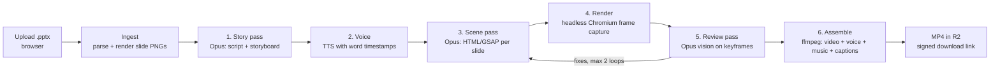

# PowerPoint2Vid v2 architecture: Opus 5.5 motion director

**Value proposition:** turn ordinary slides into extraordinary explainer videos.

Today the app redraws slides on a canvas in the browser, with preset motion and the device's speech voices. v2 adds a server-side pipeline where **Claude Opus 5.5 (`claude-opus-5-5`)** acts as the creative director and motion designer for every slide. It doesn't just animate the existing layout; it redesigns each slide as a bespoke animated scene, writes the narration, times the animation to the voice, then watches its own render and fixes what looks wrong.

## Pipeline

### 0. Ingest
- Browser uploads the `.pptx` to R2 (signed upload URL). The existing `pptx-parser.js` output (text, shapes, images, notes, theme colours) is sent with it, so the server doesn't need to reparse.
- Render container converts the deck to one PNG per slide (LibreOffice → PDF → `pdftoppm`) and extracts embedded images and the brand palette.

### 1. Story pass (one Opus call per deck)
Input: every slide's PNG + parsed text + speaker notes + the chosen video style + target length.
Output (structured JSON via tool use):
- **Narration script** per slide, rewritten from notes (or written from slide content when notes are empty) so the whole deck reads as one story with a hook and a close.
- **Storyboard** per slide: the core idea, which elements to keep, cut or split, the visual metaphor, the camera move, the transition into the next scene, and **beats** (named moments in the script, e.g. "revenue figure lands").
- **Design brief** for the deck: palette pulled from the deck's theme, type pairing, motion personality (from the style presets in `docs/VIDEO_STYLES.md`).

Seeing the whole deck at once is what lets Opus make it feel like one film rather than ten animated slides.

### 2. Voice
- TTS provider with **word-level timestamps** (e.g. ElevenLabs, OpenAI or Google Cloud TTS; pick on voice quality and price).
- Beats from step 1 are mapped to timestamps, so the timing for "revenue figure lands" is the exact second the narrator says it.
- Optional licensed music bed, ducked under the voice.

### 3. Scene pass (one Opus call per slide, run in parallel)
Opus writes a self-contained scene: HTML + CSS + a **GSAP timeline** (or SVG/Canvas for data viz), 1920×1080, built on a fixed scene runtime:
- `scene.duration`, `scene.beats` (seconds) and the design brief are injected.
- The timeline must be **paused and seekable** (`tl.seek(t)`). The renderer drives time; nothing uses wall-clock timers. This makes every frame deterministic and re-renderable.
- Allowed libraries are vendored locally (GSAP, a chart lib, Lottie player, fonts). No network.
- The deck's own images are available as local assets; charts are rebuilt as animated vector charts from the parsed data.

The deck-level design brief and scene runtime docs go in a **cached system prompt** (prompt caching), so per-slide calls only pay full price for the slide-specific part.

### 4. Render
- Headless Chromium in a container loads each scene, steps `tl.seek(frame / 30)` and screenshots every frame (or uses `HeadlessExperimental.beginFrame`). Equivalent to Remotion's approach, without the licence question.
- Scenes render in parallel and are encoded per scene, so a 10-slide deck renders in roughly the time of the longest slide, not real time.
- **Sandbox:** generated code runs with all network requests blocked except the local asset server, no filesystem access, a CPU/time limit per scene, and a fresh browser context per job.

### 5. Review pass (Opus vision)
- For each scene, build a contact sheet of keyframes (start, each beat, end) and send it to Opus with the storyboard.
- Opus checks for text overflow or clipping, overlaps, illegible contrast, elements off-frame, empty frames, and whether each beat actually shows what the script says.
- It returns either "pass" or a patched scene. Max 2 fix loops per scene, then fall back to the last good render (or the current canvas renderer for that slide), so a job always finishes.

### 6. Assemble
`ffmpeg` concatenates scenes with the planned transitions, mixes voice and music (loudness-normalised to −14 LUFS), adds a captions track (`.vtt` from the word timestamps, optionally burned in), and writes H.264 MP4 at 1080p plus a poster frame. Stored in R2; the user gets an email and a signed download link.

## Hosting (Cloudflare-first, matches the current site)

| Part | Service |
|---|---|
| Site, accounts, Stripe webhook | Existing Cloudflare Pages + Functions + KV (`ACCOUNTS`) |
| Uploads, assets, finished videos | **R2** (auto-delete after 7 days; user can delete sooner) |
| Job records and status | **D1** (jobs, scenes, attempts, costs) |
| Job orchestration | **Cloudflare Workflows** (durable steps, retries) or Queues |
| Opus calls | From the Workflow, via the Anthropic API (`ANTHROPIC_API_KEY` secret) |
| Rendering (Chromium, ffmpeg, LibreOffice) | **Cloudflare Containers**; fallback Fly.io or Modal if GPU/CPU limits bite |
| Progress UI | Poll `/api/jobs/:id`, or a Durable Object WebSocket for live scene thumbnails |

## Product and billing

- **Credits, not unlimited exports.** Each video has real cost, so plans include a monthly allowance of video minutes (e.g. 30 / 120 / 400 min), with top-ups. Stripe metered usage or one-off credit packs; the webhook already exists.
- **Rough cost per 10-slide deck** (Opus 5.5 at $4 / $20 per million input/output tokens, before caching): story pass ~$0.20, scene code ~$0.80, review and fixes ~$0.40, so **~$1–2 in Claude usage**, plus TTS (~$0.10–0.50 per minute depending on provider) and render compute (cents). Opus 5.5 uses the newer tokenizer (~30% more tokens per text than older models), so confirm with the token-counting endpoint on real decks. Prices: https://platform.claude.com/docs/en/about-claude/pricing
- **Edit loop:** the user can change a slide's script or ask for a change in plain words ("make the chart bigger, punchier"). Only that scene is regenerated and re-rendered.
- **Keep the browser renderer** as the instant, free-to-run preview while the real render is queued.

## Changes the site copy will need

The current site promises the deck never leaves the device ("Private by design", the FAQ answer about uploads, `pptx-parser.js` comments). v2 uploads the deck. Before launch, update the copy and add a privacy page covering: what's sent to Anthropic and the TTS provider, retention (auto-delete after 7 days), and that customer content isn't used for model training under Anthropic's commercial terms (confirm current terms before stating it).

## Licences to check before launch

- **GSAP** (scene runtime): free under GSAP's "standard no-charge" licence, which restricts use in tools that compete with Webflow's visual animation builder. PowerPoint2Vid outputs video files, so it likely fits, but confirm. Fallback: anime.js (MIT) behind the same `ctx.tl` contract.
- **Piper voices**: check each voice model's licence; production should use a commercial TTS provider anyway.

## Build order

Prototype status (Oct 2026): steps 1 and 2 are in `studio/` (see `studio/README.md`). The director (`studio/director.mjs`) is written but hasn't run against the API yet.

1. Scene runtime + renderer container: hand-write 2 scenes, prove deterministic frame capture and ffmpeg assembly.
2. Scene pass: Opus generates scenes for the 5-slide example deck; compare against the current homepage video.
3. Story pass + TTS with beat timing.
4. Review loop.
5. Jobs, R2, D1, Workflow, progress UI.
6. Credits in Stripe, edit loop, privacy copy, launch.
